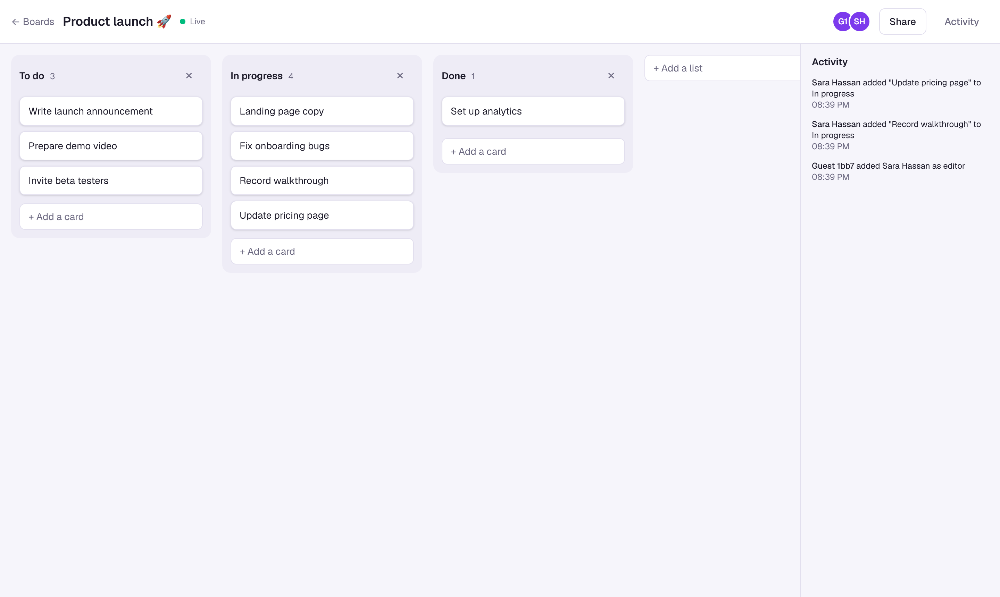
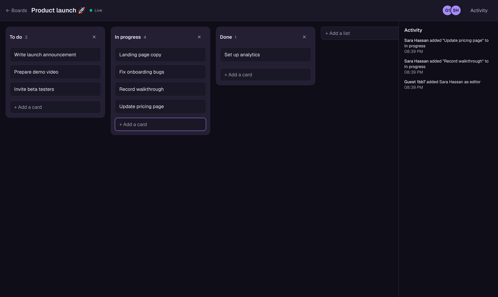
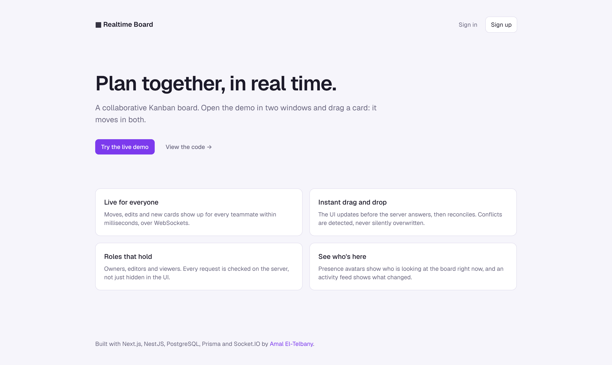
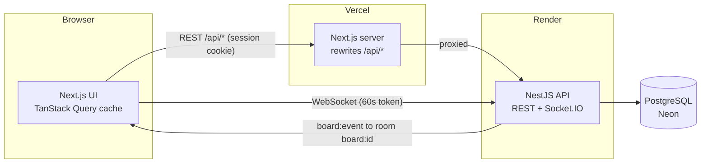

# Realtime Board

A collaborative Kanban board where every change shows up for your teammates instantly. Drag a card in one window and watch it move in the other.

**Next.js 16 · NestJS 12 · PostgreSQL · Prisma 7 · Socket.IO · TanStack Query · dnd-kit · Zod**



<p align="center"> </p>

## Features

- **Live collaboration:** card moves, edits, new lists and invites reach every viewer over WebSockets
- **Optimistic drag and drop:** the card moves the moment you drop it, then reconciles with the server
- **Conflict detection:** two people editing the same card can't silently overwrite each other
- **Roles:** owner, editor and viewer, enforced on every API call and every socket join
- **Presence and activity:** see who is on the board right now and what changed
- **One-click demo:** a throwaway account with a sample board, no sign-up needed

## Architecture



A write always goes through REST. After the database commits, the API broadcasts a typed event to the board's Socket.IO room, and every other open tab applies it to its cached board.

```text
apps/api       NestJS: auth, boards/lists/cards, Socket.IO gateway, Prisma
apps/web       Next.js App Router: pages, board UI, realtime hook
packages/shared  Zod schemas, DTO and event types, ordering helpers (used by both apps)
e2e            Playwright: two browsers collaborating on one board
```

## Design decisions

**Ordering with fractional indexes.** Each card has a string `position` that sorts between its neighbours (`a0`, `a0V`, `a1`). Moving a card writes one row instead of renumbering the whole list, and two people moving different cards don't touch each other's rows. Postgres usually uses a locale-aware collation, which doesn't sort byte by byte (it compares letters ignoring case first) and would scramble these keys. So the column uses `COLLATE "C"` to sort exactly like JavaScript's `<` does (see the init migration).

**The server decides positions.** The client sends the card's new neighbours, not a position. The API computes the key, so a buggy or stale client can't corrupt ordering. If the neighbours are out of order (the client's view is stale), the API returns 409 and the client refetches.

**Optimistic concurrency on cards.** Every card has a `version`. Updates run `UPDATE … WHERE id = ? AND version = ?`; if another write landed first, nothing matches and the API returns 409 with the current card. The UI shows "Someone else changed this card" instead of overwriting it. No locks are held, so this stays cheap under normal, low-contention use.

**Optimistic UI without echo loops.** Each tab has a client id it sends as `x-client-id`. Broadcasts carry it back as `originClientId`, so the tab that made a change ignores its own echo (it already applied it), while every other tab applies it. Older versions of a card arriving late are ignored.

**Cookies that browsers don't block.** The web app (Vercel) and API (Render) are on different domains, and cross-site cookies are increasingly blocked. So the browser only talks REST to the web app's own domain, which proxies `/api/*` to the API: the httpOnly session cookie stays first-party. WebSockets can't go through that proxy, so the client trades its session for a 60-second socket token and connects directly. The two token types can't be used in place of each other.

**Authorisation in one place.** `BoardAccessService.requireRole()` is called by every board read and write and by the socket `join`. Non-members get 404 rather than 403, so board ids can't be probed.

**Shared contracts.** Request schemas and event types live in `packages/shared`. The API validates with the same Zod schemas the forms use, and a change to an event type breaks the build on both sides instead of at runtime.

### Known limits and what I'd do next

- **One API instance.** Socket.IO rooms live in memory. To scale out, add the Redis adapter (`@socket.io/redis-adapter`) so a broadcast from one instance reaches sockets on another.
- **Events after commit, not in it.** If the process dies between the commit and the broadcast, viewers miss that event until their next reconnect, which triggers a full refetch. A transactional outbox would make delivery guaranteed.
- **Free-tier hosting** sleeps after inactivity, so the first request can take ~30 seconds.

## Testing

| Layer | What it covers | Command |
|---|---|---|
| Shared unit | Fractional index ordering, including 500 inserts at the same spot | `pnpm --filter @board/shared test` |
| API unit | Validation pipe, stale-neighbour handling | `pnpm --filter api test` |
| API end-to-end | Real Postgres and sockets: auth, roles, ordering, 409 conflicts, broadcasts, presence | `pnpm --filter api test:e2e` |
| Web unit | Board state reducer: moves, out-of-order events | `pnpm --filter web test` |
| Browser | Two users in two browsers: share, drag, see it move live, viewer restrictions | `pnpm --filter @board/e2e test:browser` |

CI runs all of them on every push, against a Postgres service container.

## Run it locally

Requires Node 22, pnpm 10 and Docker (or any Postgres 16).

```bash
pnpm install
docker compose up -d                       # Postgres on :5432
cp apps/api/.env.example apps/api/.env
cp apps/web/.env.example apps/web/.env.local
pnpm --filter @board/shared build
pnpm --filter api db:migrate               # creates the tables
pnpm dev                                   # API on :4000, web on :3000
```

Open http://localhost:3000, click **Try the live demo**, then open the same board in a second (private) window.

## Deploy

1. **Database:** create a free Postgres on [Neon](https://neon.tech) and copy its connection string.
2. **API on Render:** New → Blueprint → this repo (uses `render.yaml`). Set `DATABASE_URL` to the Neon URL and `WEB_ORIGIN` to the Vercel URL. Migrations run on every deploy.
3. **Web on Vercel:** import the repo with root directory `apps/web`. Set `API_URL` and `NEXT_PUBLIC_SOCKET_URL` to the Render URL.

---

Built by [Amal El-Telbany](https://portfolio-amaleltelbany.vercel.app).
